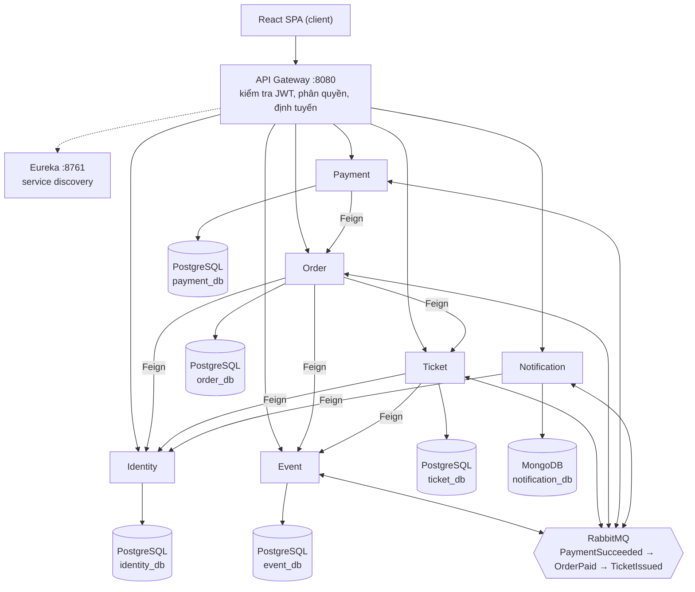

# OpenEvent – Tài liệu Yêu cầu Dự án MSS301

OpenEvent là nền tảng tổ chức và bán vé sự kiện, gồm 5 business service và Identity service. Thách thức chính là không bán vượt số vé khi nhiều người đặt cùng lúc. Tài liệu đi theo template Tài liệu đề tài (mục 6) của môn MSS301 và là bản nháp cho CP1.

## Trang bìa

- **Môn học:** MSS301 – Microservices with Spring Boot · **Lớp:** SE19B04 · **Học kỳ:** FA26
- **Tên dự án:** OpenEvent – Event Management & Ticketing Platform · **Đề tài số:** Tự đề xuất
- **Nhóm:** OpenEvent · **Giảng viên:** TraLTB · FPT Da Nang campus, 2026

| STT | MSSV | Họ tên | Vai trò | Service phụ trách |
| --- | --- | --- | --- | --- |
| 1 | <DExxxxxx> | <Họ tên> | Nhóm trưởng | Identity Service + API Gateway + Eureka + Notification Service |
| 2 | <DExxxxxx> | <Họ tên> | Thành viên | Event Service + Payment Service |
| 3 | <DExxxxxx> | <Họ tên> | Thành viên | Ticket Service |
| 4 | <DExxxxxx> | <Họ tên> | Thành viên | Order Service (Saga) |

Nhóm có 4 người. Hai service lõi của bài toán chống overselling (Ticket, Order) mỗi service do một người phụ trách riêng. Notification và Payment được giao cho hai thành viên còn lại vì Notification ít phụ thuộc và Event xong sớm, không trùng thời gian làm Payment.

## 1. Giới thiệu dự án

### 1.1 Bài toán & tổng quan sản phẩm

Các câu lạc bộ, trường học và doanh nghiệp nhỏ thường bán vé sự kiện qua Google Form và chuyển khoản tay. Cách này dễ bán quá số chỗ, khó đối soát và không kiểm soát được check-in. OpenEvent cho phép **Organizer** tạo sự kiện và các loại vé, **Attendee** tìm và mua vé online, nhận vé QR qua email, và **Admin** duyệt sự kiện, quản lý người dùng.

Hệ thống hợp với microservices vì các miền nghiệp vụ tách biệt rõ (sự kiện, vé, đơn hàng, thanh toán, thông báo) và có tải khác nhau. Ticket và Order chịu tải đột biến lúc mở bán, còn Event chủ yếu được đọc. Mỗi phần vì vậy có thể mở rộng và xử lý lỗi độc lập.

### 1.2 Vai trò người dùng và chức năng

Hệ thống có 3 vai trò: Attendee, Organizer, Admin. Khách chưa đăng nhập (Guest) chỉ xem được danh sách và chi tiết sự kiện.

**Attendee (người tham dự)**

| # | Tên chức năng | Mô tả chức năng | Service |
| --- | --- | --- | --- |
| 1 | Đăng ký / đăng nhập | Đăng ký bằng email + mật khẩu hoặc đăng nhập bằng Google, nhận JWT | Identity |
| 2 | Quản lý hồ sơ | Xem, sửa thông tin cá nhân, đổi mật khẩu | Identity |
| 3 | Tìm kiếm sự kiện | Tìm theo tên, danh mục, thành phố, khoảng ngày; có phân trang | Event |
| 4 | Xem chi tiết sự kiện | Thông tin, địa điểm, lịch, các loại vé và số vé còn lại (SPA gọi riêng Event và Ticket rồi ghép kết quả) | Event, Ticket |
| 5 | Đặt vé | Chọn loại vé và số lượng; vé được giữ 10 phút chờ thanh toán | Order, Identity, Event, Ticket |
| 6 | Thanh toán | Thanh toán qua VNPay sandbox (hoặc cổng giả lập) | Payment |
| 7 | Xem vé của tôi | Danh sách vé đã mua, mã QR từng vé | Ticket |
| 8 | Lịch sử đơn hàng | Xem đơn và trạng thái (PENDING, PAID, CANCELLED, EXPIRED) | Order |
| 9 | Hủy đơn | Hủy đơn chưa thanh toán; vé được trả lại kho | Order, Ticket |
| 10 | Nhận thông báo | Email xác nhận vé, thông báo sự kiện bị hủy (nhắc lịch 24 giờ thuộc phần dự phòng, mục 3.5) | Notification |

**Organizer (ban tổ chức)**

| # | Tên chức năng | Mô tả chức năng | Service |
| --- | --- | --- | --- |
| 1 | Đăng nhập | Đăng nhập bằng tài khoản có vai trò ORGANIZER | Identity |
| 2 | Tạo / sửa sự kiện | Nhập tên, mô tả, danh mục, địa điểm, thời gian, ảnh bìa; lưu nháp | Event |
| 3 | Gửi duyệt sự kiện | Chuyển sự kiện từ DRAFT sang PENDING_APPROVAL | Event |
| 4 | Quản lý loại vé | Tạo loại vé (VIP, Thường, Early Bird): giá, số lượng, thời gian mở bán | Ticket |
| 5 | Hủy sự kiện | Hủy sự kiện; vé bị hủy, đơn đã thanh toán chờ hoàn tiền, người mua nhận email (KB-5) | Event, Ticket, Order, Payment, Notification |
| 6 | Check-in | Quét hoặc nhập mã vé tại cửa; mỗi vé chỉ check-in một lần | Ticket |
| 7 | Xem thống kê | Số vé đã bán, doanh thu, tỉ lệ check-in theo sự kiện. SPA gọi riêng Order (doanh thu) và Ticket (vé, check-in); mỗi service tự xác minh quyền organizer qua Event | Order, Ticket, Event |
| 8 | Danh sách người tham dự | Xem và xuất danh sách người đã mua vé; Ticket lấy họ tên, email từ Identity | Ticket, Identity |

**Admin (quản trị viên)**

| # | Tên chức năng | Mô tả chức năng | Service |
| --- | --- | --- | --- |
| 1 | Quản lý người dùng | Xem, tìm, khóa/mở khóa tài khoản; cấp vai trò ORGANIZER | Identity |
| 2 | Duyệt sự kiện | Duyệt (PUBLISHED) hoặc từ chối (REJECTED) kèm lý do | Event |
| 3 | Quản lý danh mục | CRUD danh mục sự kiện (Hội thảo, Âm nhạc, Thể thao, Workshop...) | Event |
| 4 | Quản lý giao dịch | Xem tất cả giao dịch thanh toán, lọc theo trạng thái; đánh dấu đã hoàn tiền | Payment |
| 5 | Dashboard hệ thống | Tổng số sự kiện, vé bán, doanh thu toàn hệ thống; SPA gọi riêng từng service rồi ghép | Event, Ticket, Order |

### 1.3 Quy tắc nghiệp vụ

- **BR-01:** Số vé đã bán cộng đang giữ của mỗi loại vé không bao giờ vượt tổng số lượng (chống overselling).
- **BR-02:** Khi đặt vé, vé được giữ 10 phút. Quá hạn mà chưa thanh toán thì đơn chuyển sang EXPIRED và vé trả về kho.
- **BR-03:** Mỗi tài khoản mua tối đa 5 vé cho mỗi sự kiện. Order kiểm tra bằng một câu lệnh nguyên tử trên bảng `user_event_quotas`, để hai request đồng thời không vượt giới hạn.
- **BR-04:** Chỉ sự kiện PUBLISHED và đang trong thời gian mở bán của loại vé mới được đặt vé. Order kiểm tra trạng thái sự kiện, Ticket kiểm tra thời gian mở bán.
- **BR-05:** Sự kiện đi theo vòng đời DRAFT → PENDING_APPROVAL → PUBLISHED hoặc REJECTED. Sự kiện REJECTED được sửa và gửi duyệt lại. PUBLISHED → CANCELLED (Organizer hoặc Admin hủy) hoặc COMPLETED (job của Event tự chuyển sau `end_time`). Chỉ Admin chuyển sang PUBLISHED.
- **BR-06:** Organizer chỉ sửa được sự kiện của mình. Không giảm số lượng loại vé xuống dưới số đã bán cộng số đang giữ.
- **BR-07:** Thời gian kết thúc sự kiện phải sau thời gian bắt đầu; thời gian mở bán vé phải kết thúc trước khi sự kiện bắt đầu.
- **BR-08:** Vé chỉ được phát hành (ISSUED, có mã QR) sau khi thanh toán thành công.
- **BR-09:** Mỗi vé chỉ check-in một lần và chỉ trong khoảng ngày diễn ra sự kiện (từ ngày `start_time` đến ngày `end_time`).
- **BR-10:** Attendee chỉ hủy được đơn PENDING. Khi Organizer hủy sự kiện, mọi vé chuyển sang CANCELLED, đơn chuyển sang CANCELLED và thanh toán đã thành công được đánh dấu REFUND_PENDING.
- **BR-11:** Mỗi giao dịch thanh toán có mã duy nhất (idempotency key), callback trùng không được xử lý hai lần. Mọi consumer RabbitMQ phải idempotent theo `messageId`.
- **BR-12:** Tài khoản bị khóa không đăng nhập được và không tạo được đơn mới. Order hỏi trạng thái tài khoản từ Identity khi tạo đơn vì JWT còn hạn không phản ánh việc vừa bị khóa.
- **BR-13:** Thanh toán thành công trên đơn đã EXPIRED hoặc CANCELLED không phát hành vé; thanh toán đó chuyển sang REFUND_PENDING.

## 2. Thiết kế cơ sở dữ liệu

Mỗi service sở hữu một database riêng. Giữa các service không có khóa ngoại: cột đánh dấu *(ref)* chỉ lưu ID của service kia. Khóa chính dùng UUID. ERD chi tiết sẽ vẽ bằng Draw.io theo đúng các bảng dưới đây.

**Identity Service – PostgreSQL `identity_db`**

| Bảng | Cột chính |
| --- | --- |
| users | id (PK), email (unique), password_hash (null với tài khoản Google), full_name, phone, avatar_url, provider (LOCAL/GOOGLE), provider_subject (mã tài khoản Google), status (ACTIVE/LOCKED), created_at, updated_at |
| roles | id (PK), name (ATTENDEE/ORGANIZER/ADMIN) |
| user_roles | user_id (FK), role_id (FK) |
| refresh_tokens | id (PK), user_id (FK), token_hash (unique, SHA-256 của token), expires_at, revoked, created_at |

**Event Service – PostgreSQL `event_db`**

| Bảng | Cột chính |
| --- | --- |
| categories | id (PK), name, slug (unique), description |
| venues | id (PK), name, address, city, capacity |
| events | id (PK), organizer_id *(ref Identity)*, category_id (FK), venue_id (FK), title, description, banner_url, start_time, end_time, status, reject_reason, created_at |

**Ticket Service – PostgreSQL `ticket_db`**

| Bảng | Cột chính |
| --- | --- |
| ticket_types | id (PK), event_id *(ref Event)*, name, price, total_quantity, sold_quantity, reserved_quantity, sale_start, sale_end, event_organizer_id, event_start_time, event_end_time (bản cache từ Event, dùng cho fallback KB-3), version |
| reservations | id (PK), order_id *(ref Order)*, ticket_type_id (FK), quantity, status (HELD/CONFIRMED/RELEASED), expires_at; unique (order_id, ticket_type_id) |
| tickets | id (PK), ticket_type_id (FK), order_id *(ref Order)*, owner_id *(ref Identity)*, code (unique, dùng cho QR), status (ISSUED/CHECKED_IN/CANCELLED), checked_in_at |
| processed_messages | message_id (PK), processed_at |

**Order Service – PostgreSQL `order_db`**

| Bảng | Cột chính |
| --- | --- |
| orders | id (PK), user_id *(ref Identity)*, event_id *(ref Event)*, total_amount, status (PENDING/PAID/CANCELLED/EXPIRED), expires_at, created_at |
| order_items | id (PK), order_id (FK), ticket_type_id *(ref Ticket)*, quantity, unit_price |
| user_event_quotas | user_id *(ref Identity)*, event_id *(ref Event)*, quantity; PK (user_id, event_id) |
| processed_messages | message_id (PK), processed_at |

**Payment Service – PostgreSQL `payment_db`**

| Bảng | Cột chính |
| --- | --- |
| payments | id (PK), order_id *(ref Order)*, user_id *(ref Identity)*, amount, method (VNPAY/MOCK), status (PENDING/SUCCESS/FAILED/REFUND_PENDING/REFUNDED), transaction_ref (unique), paid_at |
| payment_logs | id (PK), payment_id (FK), raw_callback, created_at |
| processed_messages | message_id (PK), processed_at |

**Notification Service – MongoDB `notification_db`** (polyglot persistence)

| Collection | Trường chính |
| --- | --- |
| notifications | _id, userId *(ref)*, type (TICKET_ISSUED/EVENT_CANCELLED; EVENT_REMINDER nếu làm phần dự phòng), title, content, channel (EMAIL/IN_APP), read, sentAt, messageId (unique) |
| email_templates | _id, code, subject, body |

## 3. Kiến trúc hệ thống

### 3.1 Sơ đồ kiến trúc

Client (React SPA) chỉ gọi vào Spring Cloud Gateway. Gateway kiểm tra JWT, xóa mọi header `X-User-*` do client gửi lên, thêm lại `X-User-Id`, `X-User-Email`, `X-User-Roles` từ token đã xác minh rồi định tuyến tới service qua Eureka. Các service gọi đồng bộ với nhau bằng OpenFeign và trao đổi sự kiện bất đồng bộ qua RabbitMQ.

Năm service nối với RabbitMQ: Event phát sự kiện hủy, bốn service còn lại tham gia Saga đặt vé. Các lời gọi Feign đi qua Eureka, không đi qua Gateway, và dùng API nội bộ `/internal/**`. Gateway chặn `/internal/**`; khi triển khai chỉ Gateway mở cổng ra ngoài.

### 3.2 Phân rã service

| Service | Trách nhiệm | Database | API chính | Gọi / sự kiện | Phụ trách |
| --- | --- | --- | --- | --- | --- |
| API Gateway (8080) | Điểm vào duy nhất, kiểm tra JWT, phân quyền theo vai trò, định tuyến, CORS | — | /api/** | Định tuyến `lb://` qua Eureka | Thành viên 1 |
| Eureka Server (8761) | Service discovery | — | Dashboard | — | Thành viên 1 |
| Identity Service (8081) | Đăng ký, đăng nhập, cấp JWT, quản lý user/vai trò | PostgreSQL: identity_db | POST /api/auth/register, /login, /google, /refresh, /logout; GET, PUT /api/users/me; PUT /api/users/me/password; GET /api/users; PUT /api/users/{id}/lock, /unlock, /roles/organizer | Cung cấp GET /internal/users/{id}, POST /internal/users/batch | Thành viên 1 |
| Event Service (8082) | CRUD sự kiện, danh mục, địa điểm; duyệt sự kiện; tìm kiếm, phân trang; job COMPLETED | PostgreSQL: event_db | GET /api/events?keyword&category&city&page, GET /api/events/{id}, POST /api/events, PUT /api/events/{id}/approve; nội bộ GET /internal/events/{id} | Phát EventCancelled | Thành viên 2 |
| Ticket Service (8083) | Loại vé, giữ vé, phát hành vé QR, check-in; job nhả reservation hết hạn | PostgreSQL: ticket_db | POST /api/ticket-types, GET /api/ticket-types?eventId, POST /api/tickets/check-in; nội bộ POST /internal/reservations | Gọi Event, Identity (Feign); nhận OrderPaid, OrderCancelled, EventCancelled; phát TicketIssued, TicketsCancelled | Thành viên 3 |
| Order Service (8084) | Tạo, hủy đơn; là một bên tham gia Saga; job hết hạn đơn | PostgreSQL: order_db | POST /api/orders, GET /api/orders/my, PUT /api/orders/{id}/cancel; nội bộ GET /internal/orders/{id} | Gọi Identity, Event, Ticket (Feign); nhận PaymentSucceeded/Failed, EventCancelled; phát OrderPaid, OrderCancelled, OrderRefundRequested | Thành viên 4 |
| Payment Service (8085) | Tạo URL thanh toán VNPay, xử lý callback, hoàn tiền | PostgreSQL: payment_db | POST /api/payments, GET /api/payments/vnpay-return (công khai, kiểm tra chữ ký), GET /api/payments, PUT /api/payments/{id}/refunded | Gọi Order (Feign); phát PaymentSucceeded/Failed; nhận OrderRefundRequested | Thành viên 2 |
| Notification Service (8086) | Gửi email, lưu thông báo in-app | MongoDB: notification_db | GET /api/notifications/my | Gọi Identity (Feign) lấy email; nhận TicketIssued, TicketsCancelled | Thành viên 1 |

### 3.3 Kịch bản giao tiếp giữa service

Nhóm triển khai 3 kịch bản OpenFeign chính (yêu cầu tối thiểu là 2) và hai luồng sự kiện. Mỗi kịch bản sẽ có sequence diagram trong báo cáo. Các lời gọi Feign phụ tới Identity (lấy email, họ tên, trạng thái tài khoản) dùng chung API nội bộ của Identity.

**KB-1: Đặt vé (Order → Identity, Order → Event, Order → Ticket, Feign)**

1. Attendee gọi POST /api/orders qua Gateway.
2. Order gọi Identity: GET /internal/users/{id} để kiểm tra tài khoản không bị khóa (BR-12).
3. Order gọi Event: GET /internal/events/{id} để kiểm tra sự kiện đang PUBLISHED (BR-04).
4. Order kiểm tra giới hạn 5 vé (BR-03), tạo đơn PENDING, rồi gọi Ticket: POST /internal/reservations để giữ vé 10 phút (BR-01, BR-02).
5. Ticket kiểm tra thời gian mở bán, giữ tất cả loại vé trong một transaction bằng câu UPDATE có điều kiện còn đủ vé, rồi trả về đơn giá. Order dùng đơn giá này để tính `total_amount`; không nhận giá từ client. Hết vé thì Ticket trả 409 và Order hủy đơn.
6. **Tính idempotent:** retry cùng `orderId` không giữ vé hai lần nhờ unique (order_id, ticket_type_id).
7. **Khi lỗi:** Event hoặc Ticket không phản hồi → Resilience4J retry 3 lần, sau đó circuit breaker mở và fallback trả 503 “Hệ thống bận, vui lòng thử lại”; đơn PENDING (nếu đã tạo) chuyển sang CANCELLED và phát `OrderCancelled`. Lỗi 4xx (như 409 hết vé) không được tính vào retry và circuit breaker. Nếu Ticket đã giữ vé nhưng Order nhận timeout, job của Ticket vẫn nhả reservation khi hết hạn.

**KB-2: Thanh toán (Payment → Order, Feign)**

1. Attendee gọi POST /api/payments với orderId.
2. Payment gọi Order: GET /internal/orders/{id} để lấy số tiền và kiểm tra đơn còn PENDING, chưa hết hạn.
3. Payment tạo URL VNPay và trả về cho client.
4. VNPay chuyển trình duyệt về GET /api/payments/vnpay-return; Payment kiểm tra chữ ký trước khi xử lý vì endpoint này công khai. Bản triển khai có URL public nên dùng thêm IPN.
5. **Khi lỗi:** Order không phản hồi → fallback từ chối tạo thanh toán (không tạo giao dịch khi chưa xác minh được số tiền).

**KB-3: Check-in (Ticket → Event, Feign)**

1. Organizer gọi POST /api/tickets/check-in với mã vé.
2. Ticket gọi Event: GET /internal/events/{id} để xác minh người gọi là organizer của sự kiện và hôm nay nằm trong khoảng ngày diễn ra (BR-09). Mỗi lần gọi thành công, Ticket cập nhật bản cache trong `ticket_types`.
3. **Khi lỗi:** Event không phản hồi → fallback đọc bản cache trong `ticket_types`.

**KB-4 (nâng cao): Saga hoàn tất đơn qua RabbitMQ (choreography)**

1. VNPay callback → Payment lưu SUCCESS, phát `PaymentSucceeded`.
2. Order nhận sự kiện, chuyển đơn sang PAID, phát `OrderPaid`.
3. Ticket nhận `OrderPaid`, xác nhận giữ vé, phát hành vé QR, phát `TicketIssued`.
4. Notification nhận `TicketIssued`, gọi Identity lấy email và gửi email kèm QR.
5. **Bù trừ:** thanh toán thất bại, hủy đơn hoặc đơn hết hạn → Order chuyển CANCELLED/EXPIRED, phát `OrderCancelled` → Ticket nhả vé về kho. Đây là cách nhả vé duy nhất từ Order.
6. **Thanh toán muộn (BR-13):** Order nhận `PaymentSucceeded` trên đơn đã EXPIRED/CANCELLED → phát `OrderRefundRequested` → Payment chuyển REFUND_PENDING; không phát hành vé.

**KB-5 (nâng cao): Hủy sự kiện qua RabbitMQ**

1. Event chuyển CANCELLED, phát `EventCancelled`.
2. Ticket hủy các vé của sự kiện, phát `TicketsCancelled` kèm danh sách người mua → Notification gửi email.
3. Order chuyển các đơn của sự kiện sang CANCELLED; với đơn đã PAID phát `OrderRefundRequested` → Payment chuyển REFUND_PENDING.

### 3.4 Công nghệ sử dụng

Dấu (*) đánh dấu công nghệ không học trên lớp; các công nghệ này sẽ được mô tả thêm trong mục 3 của báo cáo.

| Nhóm | Công nghệ |
| --- | --- |
| Back-end | Java 21, Spring Boot 4.0, Maven, Spring Web, Spring Data JPA, Spring Data MongoDB, Flyway (*), Bean Validation, Lombok, MapStruct |
| Hạ tầng | Spring Cloud 2025.1: Netflix Eureka, Spring Cloud Gateway, OpenFeign, Resilience4J; RabbitMQ (*) |
| Bảo mật | Spring Security, JWT (access + refresh token), BCrypt, Google OAuth2 (*) |
| Database | PostgreSQL 16 (Identity, Event, Ticket, Order, Payment), MongoDB 7 (Notification) |
| Front-end | React 18 + Vite, React Router, Axios, TailwindCSS (*) |
| Thanh toán & email | VNPay sandbox (*), Spring Mail + Gmail SMTP, thư viện ZXing tạo mã QR (*) |
| Kiểm thử | JUnit 5, Mockito, Postman, Testcontainers (*) |
| Đóng gói & quy trình | Docker, Docker Compose, GitHub (issues, PR template, Projects board, milestones), GitHub Actions (*) |
| Tài liệu API | springdoc-openapi cho từng service; Swagger tổng hợp tại Gateway thuộc phần dự phòng |

### 3.5 Thách thức chính & tính năng nâng cao

**Thách thức chính: chống bán vượt số vé khi nhiều người đặt cùng lúc.** Khi mở bán, hàng trăm người có thể cùng mua số vé cuối cùng. Nhóm giải quyết bằng 4 biện pháp:

1. Giữ vé bằng một câu lệnh nguyên tử: `UPDATE ticket_types SET reserved_quantity = reserved_quantity + :q WHERE id = :id AND total_quantity - sold_quantity - reserved_quantity >= :q`. Số dòng cập nhật bằng 0 nghĩa là hết vé.
2. Organizer sửa số lượng cũng bằng câu lệnh có điều kiện: `UPDATE ticket_types SET total_quantity = :n, version = version + 1 WHERE id = :id AND :n >= sold_quantity + reserved_quantity`. Không lưu cả entity bằng JPA vì có thể ghi đè `reserved_quantity` bằng giá trị cũ. Cột `version` chỉ dùng cho các trường mô tả như tên và giá.
3. Giữ vé có thời hạn 10 phút; job `@Scheduled` mỗi phút của Order quét đơn hết hạn, job của Ticket nhả reservation hết hạn phòng khi mất sự kiện hoặc timeout (BR-02).
4. Saga đảm bảo đơn, thanh toán và vé nhất quán giữa 3 database, có bước bù trừ khi lỗi (KB-4).

Nhóm sẽ chứng minh bằng một bài test gửi 100 request đồng thời từ 100 tài khoản vào loại vé còn 10 chỗ: kết quả phải là đúng 10 đơn thành công.

**Tính năng nâng cao nhóm cam kết** (mục 3 của yêu cầu, tối đa +10 điểm):

| Ưu tiên | Mục nâng cao | Service |
| --- | --- | --- |
| 1 | Resilience4J circuit breaker + retry cho các lời gọi Feign | Order, Payment, Ticket |
| 2 | Sự kiện bất đồng bộ RabbitMQ + Saga đặt vé | Event, Payment, Order, Ticket, Notification |
| 3 | Polyglot persistence (MongoDB) | Notification |
| 4 | Thanh toán sandbox VNPay + email xác nhận | Payment, Notification |
| 5 | Đăng nhập Google (OAuth2) + refresh token | Identity |
| Dự phòng | Swagger tổng hợp tại Gateway, CI GitHub Actions, WebSocket cập nhật số vé còn lại, email nhắc lịch trước 24 giờ, outbox cho việc phát sự kiện | Gateway, Ticket, Notification |

Nếu trễ tiến độ, nhóm cắt theo thứ tự: WebSocket, nhắc lịch 24 giờ, thông báo in-app, Google OAuth2.

## 4. Kế hoạch

### 4.1 Phân công & timeline

TV1–TV4 là Thành viên 1–4 ở trang bìa. Mỗi thành viên làm trên nhánh `feature/<service>-<tính năng>` và merge vào `develop` qua pull request có review.

| Tuần | Công việc | Người phụ trách | Sản phẩm đầu ra | Checkpoint |
| --- | --- | --- | --- | --- |
| 1 | Phân tích yêu cầu, phân rã service, ERD, sơ đồ kiến trúc; tạo repo, board, milestone | Cả nhóm | Tài liệu đề tài này, ERD, bảng phân công | CP1 |
| 2 | Khởi tạo 6 service + Eureka + Gateway; docker-compose cho PostgreSQL, MongoDB, RabbitMQ; Identity với JWT; Gateway lọc token và truyền `X-User-*` để các service có thông tin người gọi từ đầu | TV1 (hạ tầng, Identity), mỗi TV tiếp nhận service của mình | Eureka hiển thị đủ service, Gateway định tuyến và bảo vệ API | — |
| 3 | Event: CRUD sự kiện, danh mục, địa điểm, tìm kiếm/phân trang, Swagger; song song CRUD cơ bản của Ticket (loại vé), Order; khung Notification | TV2, TV3, TV4, TV1 | API Event test được qua Gateway | — |
| 4 | Hoàn thiện CRUD Ticket, Order, Payment, Notification; Postman collection chung | TV1, TV2, TV3, TV4 | Mọi service có CRUD cơ bản | CP2 |
| 5 | Quy tắc BR-01 đến BR-13, DTO + validation, unit test tầng service | Mỗi TV với service của mình | Báo cáo unit test | — |
| 6 | KB-1 đến KB-3 bằng OpenFeign + Resilience4J; KB-4, KB-5 qua RabbitMQ; test 100 request đồng thời; bắt đầu khung React SPA | TV2, TV3, TV4; TV1 hoàn tất Notification và khung SPA | Sequence diagram, kết quả test overselling | Báo cáo §3 |
| 7 | Gắn phân quyền chi tiết cho API của từng service; cấu hình Google OAuth2 thật; kiểm thử bảo mật; làm màn hình đăng nhập, trang chủ, chi tiết sự kiện | TV1 điều phối, mỗi TV với service của mình | Back-end đã bảo mật | CP3 |
| 8 | React SPA: đặt vé + thanh toán, vé của tôi, trang Organizer, trang Admin | Mỗi TV làm màn hình của service mình | Screen flow, screenshots | Báo cáo §4.2 |
| 9 | Test E2E luồng đăng nhập → tìm sự kiện → đặt vé → thanh toán → nhận email → check-in; Docker hóa; README, dữ liệu mẫu, báo cáo, slide | Cả nhóm | docker compose up chạy toàn bộ | CP4 |
| 10 | Thuyết trình, demo, hỏi đáp | Cả nhóm | Demo | Bảo vệ |

### 4.2 Rủi ro

| Rủi ro | Ảnh hưởng | Phương án dự phòng |
| --- | --- | --- |
| VNPay sandbox lỗi hoặc không đăng ký được | Không demo được thanh toán | Payment Service có chế độ MOCK (bật bằng cấu hình) giả lập callback thành công/thất bại |
| Saga qua RabbitMQ phức tạp, trễ tiến độ tuần 6 | Mất điểm thưởng, luồng đặt vé chưa hoàn chỉnh | Làm trước phiên bản đồng bộ bằng Feign (Payment gọi Order, Order gọi Ticket); RabbitMQ thay vào sau |
| Máy yếu, Docker Compose chạy 8 ứng dụng + PostgreSQL + MongoDB + RabbitMQ bị thiếu RAM | Khó chạy demo | Giới hạn heap JVM (-Xmx256m) mỗi service; chạy riêng các service cần thiết; thử chạy toàn bộ từ tuần 6 |
| Nhóm chỉ có 4 người, TV1 và TV2 mỗi người kiêm nhiều service | Một người trễ ảnh hưởng nhiều service | Notification xong trước tuần 7; review chéo để người khác có thể tiếp quản; cắt tính năng theo thứ tự ở mục 3.5 |
